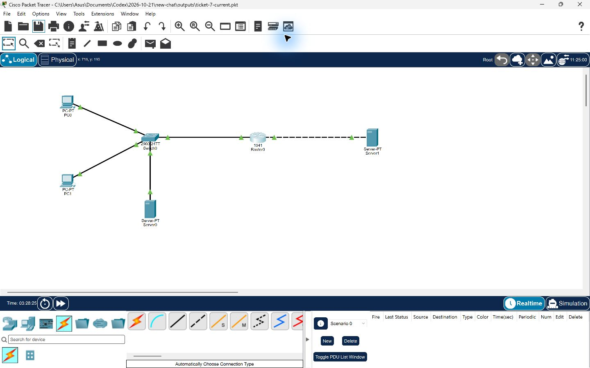
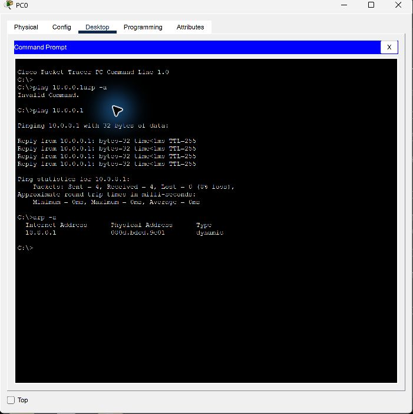
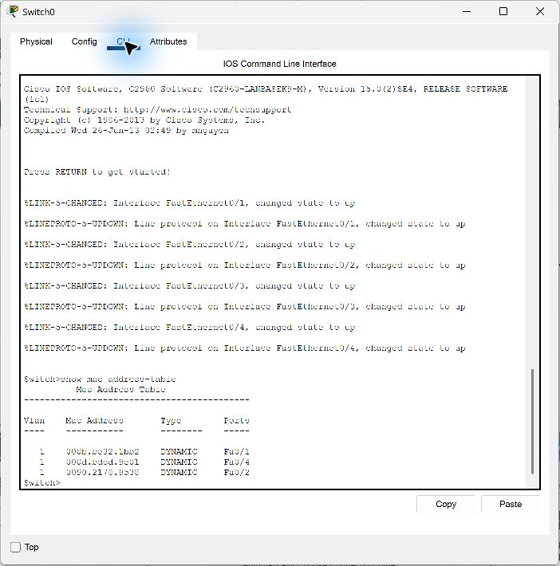
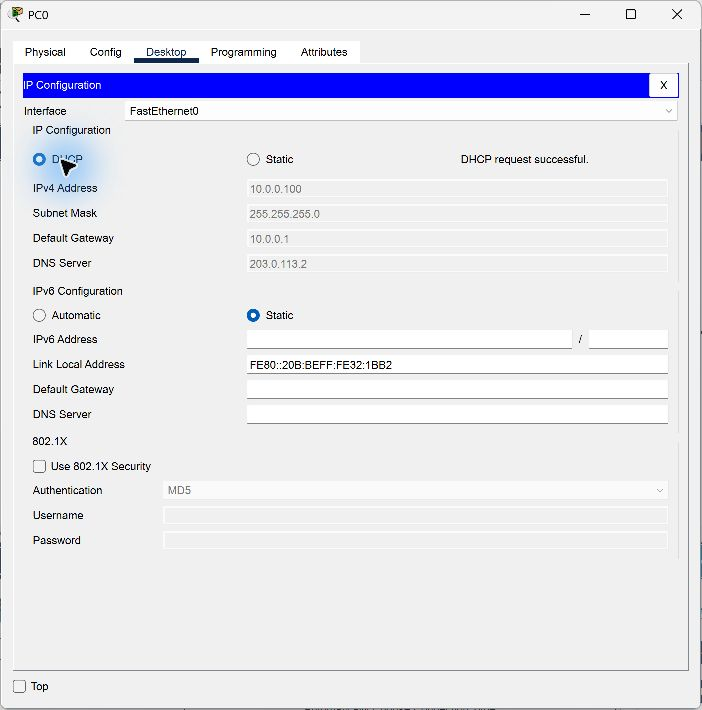
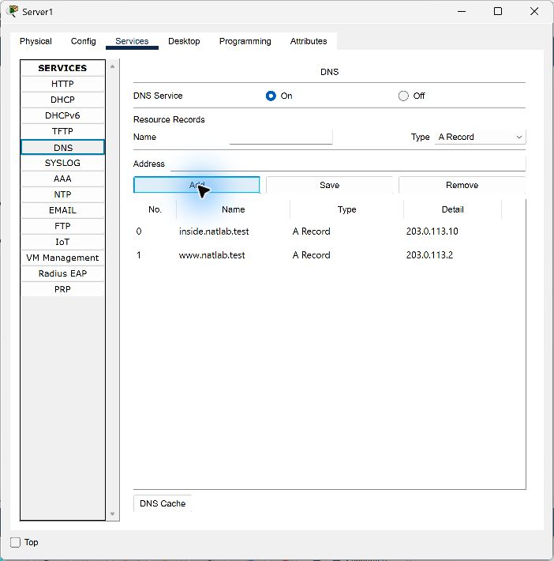
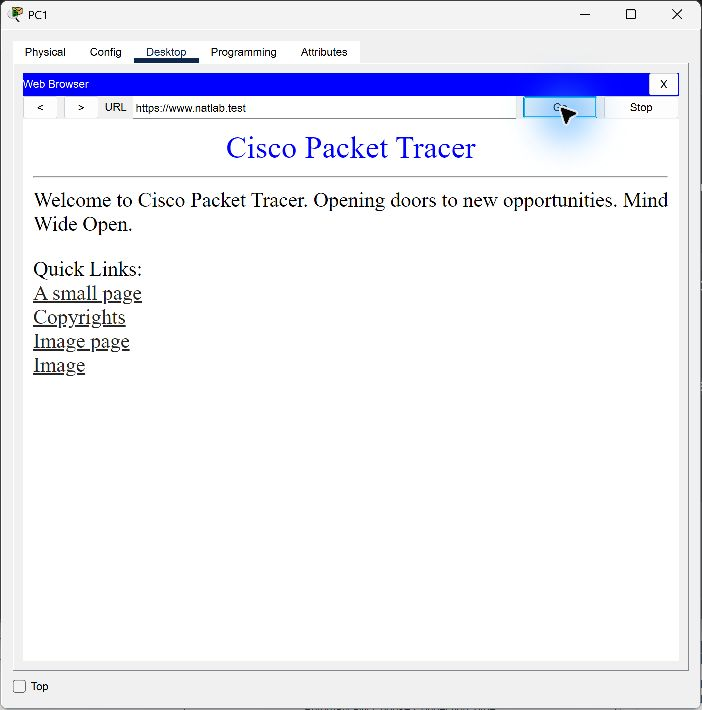
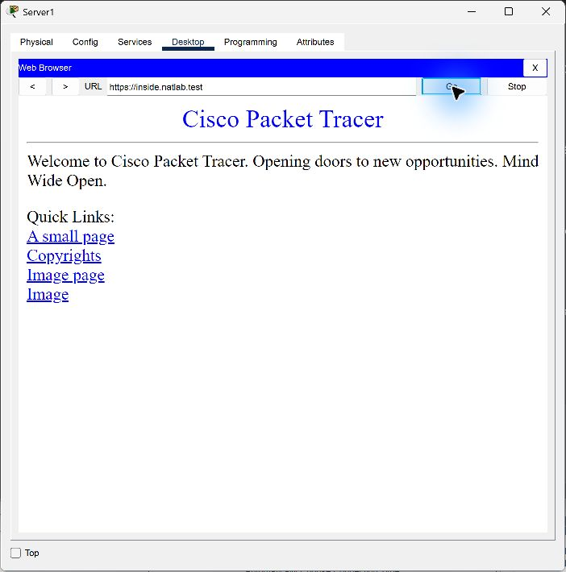
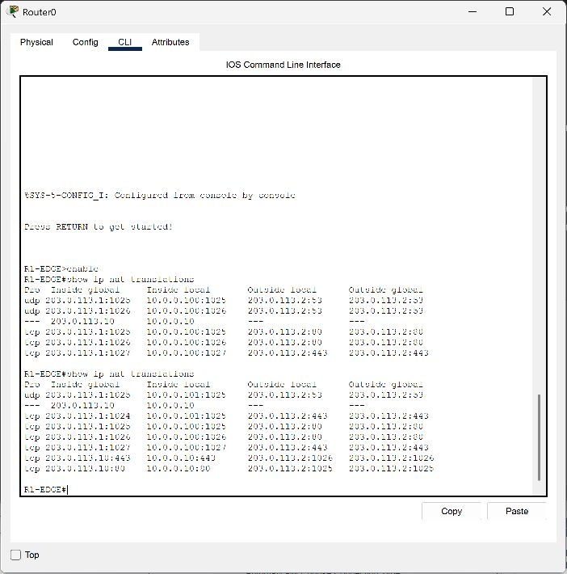

# Билет 7 — NAT и PAT в действии

Лабораторная работа выполнена в Cisco Packet Tracer 9.0.1. Настроены частная сеть, DHCP, внешний DNS, статический NAT и PAT overload. Проверены ARP и MAC-таблица до NAT, доступ к внешнему сайту и входящий доступ к внутреннему серверу по HTTP и HTTPS.

## Файлы работы

- [Открыть проект Packet Tracer](../../.github/pkt/ticket-07-nat-pat.pkt)
- [Итоговая конфигурация роутера](configs/router-final.txt)
- [Базовая конфигурация до NAT](configs/router-before-nat.txt)
- [Команды включения NAT и PAT](configs/router-enable-nat.txt)
- [Вывод ARP](results/arp-before-nat.txt), [MAC-таблица](results/mac-before-nat.txt), [таблица NAT](results/nat-translations.txt)

Ссылку на проект можно скачать через кнопку **Download raw file** и открыть файл `.pkt` в Packet Tracer. Конфигурация роутера сохранена в NVRAM. Динамические трансляции создаются заново при выполнении запросов.

## Схема сети



PC0, PC1 и внутренний Server0 подключены к коммутатору Switch0. Router0, hostname R1-EDGE, соединяет LAN и внешнюю учебную сеть. Server1 выполняет роли внешнего DNS и веб-сервера. Обе сети непосредственно подключены к роутеру, поэтому дополнительный статический маршрут не требуется.

## Расчёт подсети

| Параметр | Значение |
|---|---|
| Частная сеть | 10.0.0.0/24 |
| Маска | 255.255.255.0 |
| Биты узлов | 8 |
| Всего адресов | 2^8 = 256 |
| Доступно адресов узлов | 256 − 2 = 254 |
| Диапазон узлов | 10.0.0.1–10.0.0.254 |
| Broadcast | 10.0.0.255 |
| Внешняя учебная сеть | 203.0.113.0/24 |

## Назначение адресов

| Устройство | Интерфейс | IPv4 и маска | Шлюз | DNS |
|---|---|---|---|---|
| R1-EDGE | G0/0, inside | 10.0.0.1/24 | — | — |
| R1-EDGE | G0/1, outside | 203.0.113.1/24 | — | — |
| PC0 | FastEthernet0 | 10.0.0.100/24, DHCP | 10.0.0.1 | 203.0.113.2 |
| PC1 | FastEthernet0 | 10.0.0.101/24, DHCP | 10.0.0.1 | 203.0.113.2 |
| Server0 | FastEthernet0 | 10.0.0.10/24 | 10.0.0.1 | 203.0.113.2 |
| Server1 | FastEthernet0 | 203.0.113.2/24 | 203.0.113.1 | 203.0.113.2 |

Switch0 работает на втором уровне и не требует IP-адреса для коммутации. Публичный адрес 203.0.113.10 зарезервирован для статического NAT внутреннего сервера.

## ARP и MAC-таблица до NAT

С PC0 выполнен `ping 10.0.0.1`: отправлено 4 пакета, получено 4, потерь нет. Команда `arp -a` показала динамическое соответствие:

| IPv4 | MAC |
|---|---|
| 10.0.0.1 | 000d.bdcd.9e01 |



На Switch0 выполнена команда `show mac address-table`:

| VLAN | MAC | Тип | Порт |
|---|---|---|---|
| 1 | 000b.be32.1bb2 | DYNAMIC | Fa0/1, PC0 |
| 1 | 0090.2178.9538 | DYNAMIC | Fa0/2, PC1 |
| 1 | 000d.bdcd.9e01 | DYNAMIC | Fa0/4, роутер |



ARP сопоставляет локальный IP с MAC, а коммутатор сопоставляет MAC с портом. Для отправки во внешнюю сеть ПК использует MAC своего шлюза. NAT изменяет IP и при PAT может менять транспортный порт; он не заменяет работу ARP и MAC-таблицы.

## DHCP

На роутере настроен пул LAN: 10.0.0.100–10.0.0.199, маска /24, шлюз 10.0.0.1, DNS 203.0.113.2. Адреса .1–.99 и .200–.254 исключены из выдачи.

```ios
ip dhcp excluded-address 10.0.0.1 10.0.0.99
ip dhcp excluded-address 10.0.0.200 10.0.0.254
ip dhcp pool LAN
 network 10.0.0.0 255.255.255.0
 default-router 10.0.0.1
 dns-server 203.0.113.2
 domain-name natlab.test
```




## Статический NAT и PAT

```ios
interface GigabitEthernet0/0
 ip nat inside
exit
interface GigabitEthernet0/1
 ip nat outside
exit
ip nat inside source static 10.0.0.10 203.0.113.10
access-list 1 permit 10.0.0.0 0.0.0.255
ip nat inside source list 1 interface GigabitEthernet0/1 overload
```

Статический NAT публикует Server0 как 203.0.113.10. PAT позволяет PC0 и PC1 обращаться к внешнему серверу через общий адрес G0/1, 203.0.113.1. Настройки сохранены командой `copy running-config startup-config`.

## Внешний DNS

На Server1 включена служба DNS и добавлены A-записи:

| Имя | IPv4 |
|---|---|
| www.natlab.test | 203.0.113.2 |
| inside.natlab.test | 203.0.113.10 |



## Проверка HTTP и HTTPS

| Источник | Адрес запроса | Результат |
|---|---|---|
| PC0, LAN | http://203.0.113.2 | Внешняя страница открыта через PAT |
| PC1, LAN | https://www.natlab.test | DNS разрешил имя, HTTPS-страница открыта через PAT |
| Server1, внешняя сеть | http://inside.natlab.test | Внутренняя страница открыта через статический NAT |
| Server1, внешняя сеть | https://inside.natlab.test | Внутренняя HTTPS-страница открыта через статический NAT |






## Фактическая таблица трансляций

Вывод `show ip nat translations` после проверок:

| Протокол | Inside global | Inside local | Outside global |
|---|---|---|---|
| UDP | 203.0.113.1:1025 | 10.0.0.101:1025 | 203.0.113.2:53 |
| — | 203.0.113.10 | 10.0.0.10 | — |
| TCP | 203.0.113.1:1024 | 10.0.0.101:1025 | 203.0.113.2:443 |
| TCP | 203.0.113.1:1025 | 10.0.0.100:1025 | 203.0.113.2:80 |
| TCP | 203.0.113.1:1026 | 10.0.0.100:1026 | 203.0.113.2:80 |
| TCP | 203.0.113.1:1027 | 10.0.0.100:1027 | 203.0.113.2:443 |
| TCP | 203.0.113.10:443 | 10.0.0.10:443 | 203.0.113.2:1026 |
| TCP | 203.0.113.10:80 | 10.0.0.10:80 | 203.0.113.2:1025 |

Outside local в этой схеме совпадает с Outside global. Полный четырёхколоночный вывод приведён в [текстовом файле](results/nat-translations.txt).



### Как меняются IP и порты

- **PAT с сохранением порта:** `10.0.0.100:1025 → 203.0.113.1:1025`, назначение `203.0.113.2:80` сохраняется.
- **PAT с заменой порта:** `10.0.0.101:1025 → 203.0.113.1:1024`. Исходный TCP-порт 1025 уже занят другой трансляцией, поэтому роутер выделил 1024. Оба ПК работают через один внешний IP.
- **Статический NAT:** входящее назначение `203.0.113.10:80/443` преобразуется в `10.0.0.10:80/443`. Порты веб-служб сохраняются. В ответах источник меняется обратно с 10.0.0.10 на 203.0.113.10.
- **DNS через PAT:** UDP-запрос PC1 к порту 53 внешнего DNS преобразуется из `10.0.0.101:1025` в `203.0.113.1:1025`. TCP и UDP имеют отдельные пространства трансляций.

## Вывод

Статический NAT обеспечил доступ извне к внутреннему серверу с постоянным публичным адресом. PAT позволил двум внутренним ПК использовать один внешний IP и различать соединения по портам. DHCP выдал корректные параметры обоим ПК, а внешний DNS обеспечил доступ к веб-сервисам по именам. HTTP и HTTPS проверены в обоих направлениях в симуляторе.
