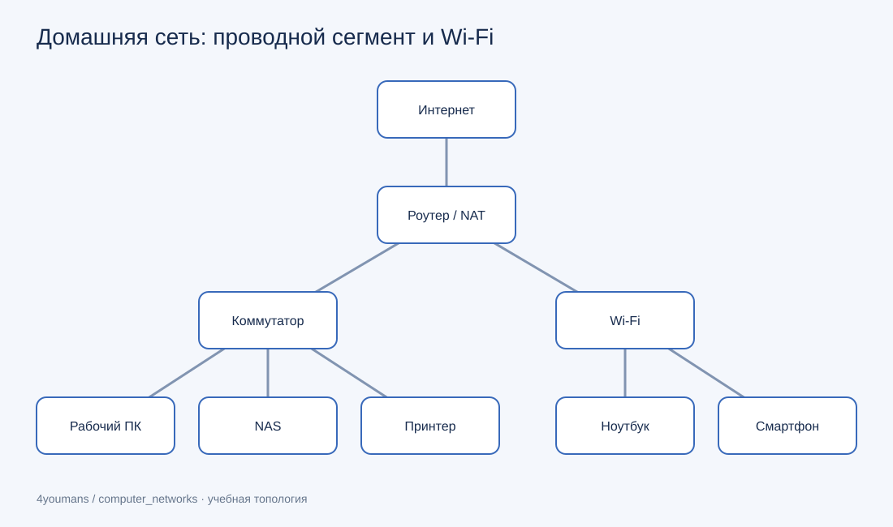
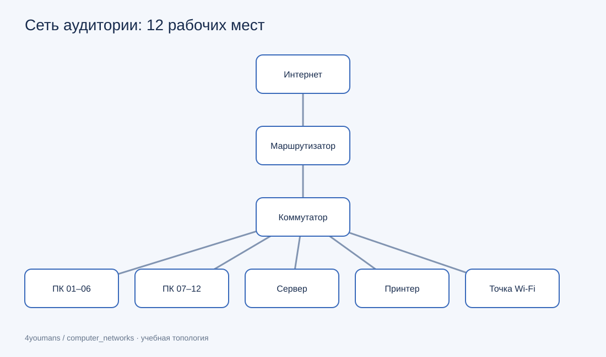

# Проектирование локальной сети

## Домашний стенд

Маршрутизатор соединяет домашнюю сеть с провайдером и выполняет NAT. К коммутатору подключены рабочий компьютер, сетевое хранилище и принтер. Ноутбук и смартфон используют Wi-Fi роутера.

[Редактируемая схема draw.io](../../.github/assets/lesson_01/home-lab-network.drawio)

Проводные устройства и Wi-Fi находятся в одной локальной подсети. Для реального развёртывания гостевую сеть стоит отделить от доступа к NAS.

## Учебная аудитория

Двенадцать рабочих мест, сервер, принтер и точка доступа подключаются к коммутатору. На схеме компьютеры сгруппированы по шесть: это обозначение отдельных подключений, а не последовательное соединение ПК.

[Редактируемая схема draw.io](../../.github/assets/lesson_01/classroom-network.drawio)

Для такой конфигурации достаточно коммутатора на 24 порта: 12 ПК, сервер, принтер, точка доступа и соединение с маршрутизатором займут 16 портов. Останется запас для расширения.