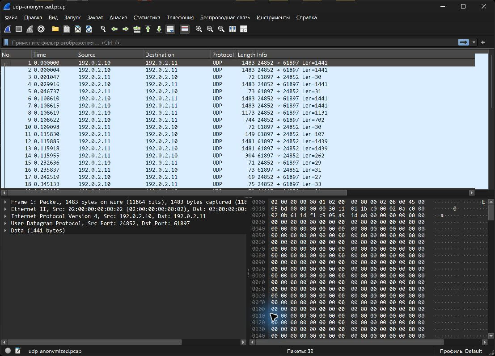

# Захват и анализ трафика в Wireshark

Интернет на компьютере раздаётся с телефона. В сохранённом захвате 455 кадров: 451 пакет IPv4/UDP и 4 кадра ARP. Запись длится около 38 секунд. TCP в этом файле отсутствует; это наблюдение относится к данной записи.

## Список пакетов

Для иллюстрации выбраны первые 32 UDP-пакета. Скриншот снят в Wireshark с обезличенной копии фактического захвата: IP-адреса заменены на адреса из документационного диапазона 192.0.2.0/24, MAC-адреса заменены, полезная нагрузка обнулена. Размеры, порты и интервалы времени сохранены, контрольные суммы пересчитаны. Исходный захват в репозиторий не включён.

Виден двусторонний обмен между портами 24852 и 61897. По одним номерам портов и размерам пакетов нельзя достоверно определить приложение или содержимое обмена.

## Разбор первого пакета

| Поле | Значение |
| --- | --- |
| Размер Ethernet-кадра в захвате | 1483 байта |
| Заголовок Ethernet II | 14 байт |
| Заголовок IPv4 | 20 байт |
| UDP Length | 1449 байт |
| Заголовок UDP | 8 байт |
| Полезная нагрузка UDP | 1441 байт |

Проверка: 14 + 20 + 8 + 1441 = 1483. Поле UDP Length включает заголовок UDP и данные: 1449 − 8 = 1441.

EtherType в Ethernet II указывает на IPv4, а поле Protocol в IPv4 имеет значение 17 — UDP. ARP используется для сопоставления локальных IPv4-адресов с MAC-адресами.

При захвате важно выбирать интерфейс, через который действительно идёт нужный трафик. Пустой захват на другом интерфейсе не означает отсутствия сетевой активности.
