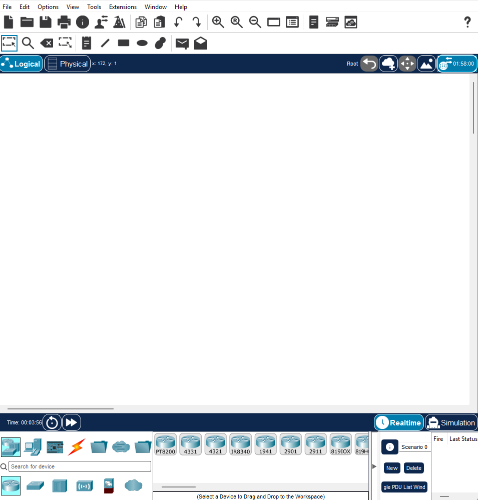

# Домашнее задание №5

## Cisco Packet Tracer

## Деление сети на подсети

Для расчёта используем частную сеть: `192.168.0.0/24`. Для пяти зданий, в каждом из которых от 15 до 25 устройств, подходит префикс `/27`. Маска: `255.255.255.224`. В каждой подсети доступно 30 адресов для устройств.

| Здание | Подсеть | Шлюз | Адреса устройств |
| --- | --- | --- | --- |
| 1 | 192.168.0.0/27 | 192.168.0.1 | 192.168.0.2 - 192.168.0.30 |
| 2 | 192.168.0.32/27 | 192.168.0.33 | 192.168.0.34 - 192.168.0.62 |
| 3 | 192.168.0.64/27 | 192.168.0.65 | 192.168.0.66 - 192.168.0.94 |
| 4 | 192.168.0.96/27 | 192.168.0.97 | 192.168.0.98 - 192.168.0.126 |
| 5 | 192.168.0.128/27 | 192.168.0.129 | 192.168.0.130 - 192.168.0.158 |

Для 10 устройств нужна подсеть `/28`, в ней доступно 14 адресов. В одной сети `/24` получится только 16 подсетей `/28`. Для 20 таких подсетей нужна исходная сеть минимум `/23`.

Расчёт: для 25 узлов нужно как минимум 5 бит адреса узла, поскольку 2⁵ − 2 = 30. Поэтому префикс равен 32 − 5 = 27, а шаг между подсетями — 32 адреса. Первый доступный адрес выбран шлюзом; широковещательный адрес в диапазон устройств не входит.

Диапазон 127.0.0.0/8 относится к loopback и для адресации устройств локальной сети не подходит.
