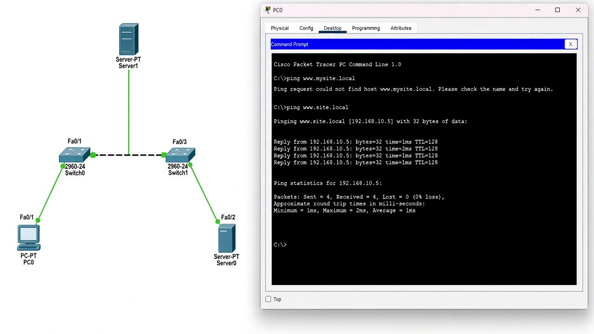

# Домашнее задание №13

Задача: собрать сеть в Cisco Packet Tracer, настроить DNS-сервер и проверить доступ к узлу по доменному имени.

[Файл Packet Tracer с настроенным DNS](../../.github/pkt/lesson_13/dns-hw.pkt)

## Проверка DNS по шагам

1. Проверить доступность сервера по IP-адресу.
2. Указать адрес DNS-сервера в настройках клиента.
3. Проверить, что A-запись содержит адрес нужного узла.
4. Выполнить запрос имени и сравнить полученный адрес с записью.

Если доступ по IP работает, а по имени отсутствует, сначала проверяются DNS-настройки. Если имя разрешается, но ping не проходит, причина может быть в маршрутизации или обработке ICMP.
